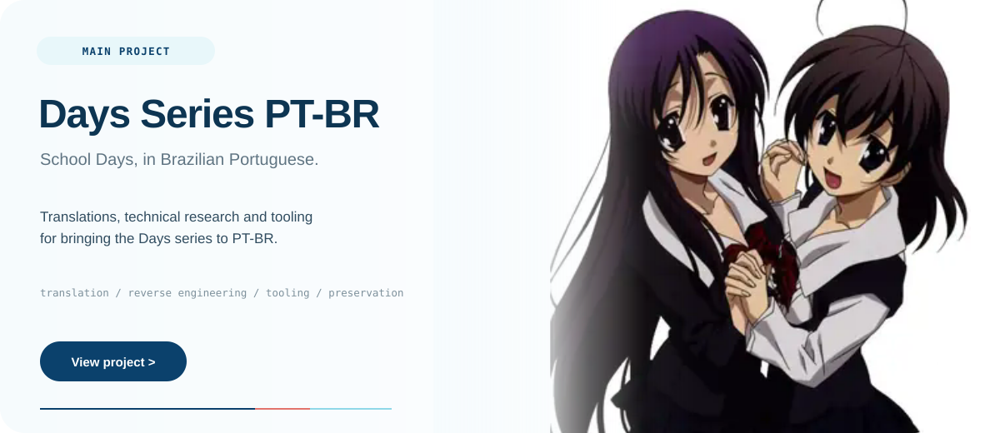

 

&nbsp; <strong>vibecoder</strong> · AI-assisted development · localization

 

I'm **SUZU**, a vibecoder focused on localization, tooling and reverse engineering.

A large part of my work is developed with **AI agents**. I direct the projects, monitor the agents, test the results and decide what actually ships.

My main goal is to use these tools to make content accessible in languages and regions where localization would otherwise demand years of specialized reverse engineering and development.

I'm a fan of the **School Days** series. It was this franchise that pushed me to start bringing these games to my native language, **Brazilian Portuguese**.

 

 

I also build independent projects and experiments from time to time, usually because something made me curious enough to ask: **can I make this work?**

 

`AI-assisted · Human-directed`

**SUZU**

